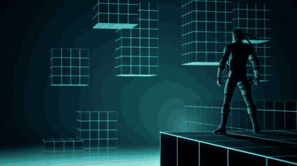
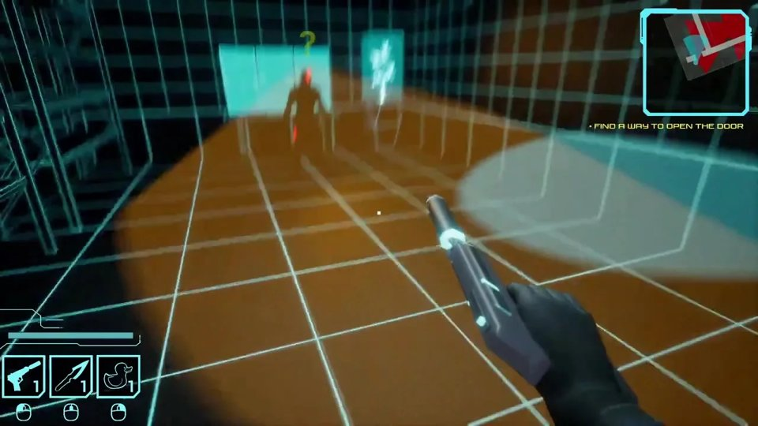
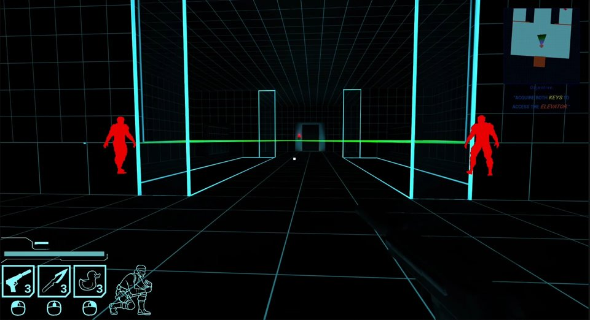
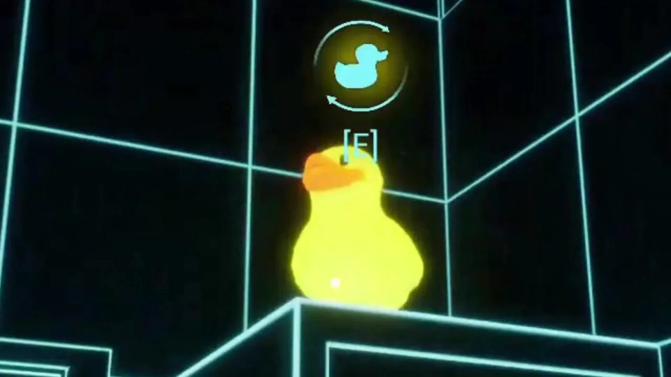
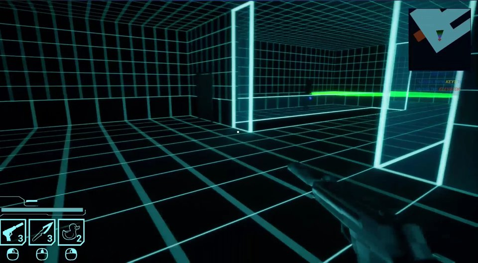

# Metal Gears



A first person stealth game set in neon training simulations. Sneak past guards and their vision cones, grab tools and distractions (yes, including a rubber duck) and find a way to open the door.

Programming 2 exam at INN, spring 2026. Team project in Unreal Engine 5, C++ and Blueprints. I was lead programmer and project lead. Visual design was led by our lead designer, Heidi.

**Trailer, screenshots and a download of the full project:** [sundorigin.org/projects.html](https://sundorigin.org/projects.html#metal-gears)

> A fan reimagining of Metal Gear Solid: VR Missions, made as a school project. Not affiliated with or endorsed by Konami. Not for sale.

| | |
| --- | --- |
|  |  |
|  |  |

## What I built

- **Player character in C++.** Movement, look, crouch, pause and the input hooks for every action
- **Stealth detection component.** A detection meter that fills while guards see you. More guards watching fills it faster, crouching slows it down, and at 100% it fires an event so the level can react.
- **Equipment component.** Gun, knife toss and the duck you throw to distract guards
- **Interaction system.** One sphere trace and an interface, so doors, vents and pickups all work the same way
- **Doors.** Normal doors, sliding doors, heavy sliding doors and vent doors
- **X-ray vision** and a procedural minimap
- Animation logic that blends by what you're holding, and the game loop

## Controls

The keys live in the Enhanced Input mapping in `Content/MetalGears/Inputclasses`. The actions are: move, look, crouch, x-ray, interact, shoot, knife toss, throw duck and pause.

## Open it

1. Install **Git LFS** before you clone. All `.uasset` and `.umap` files are stored with LFS.
2. Clone the repo and right click `MetalGearsExam.uproject` > Generate Visual Studio project files
3. Open in **Unreal Engine 5.7** and build from Visual Studio or Rider

If you just want to look around, the full dev folder is also on [Google Drive](https://drive.google.com/file/d/1GhP6E6ldNZiKdYT9eMLmfdAIs0cgn-VI/view?usp=sharing) (676 MB zip).

## Code

```
Source/MetalGearsExam/
  MainPlayerChar             the player
  StealthDetectionComponent  how guards spot you
  PlayerEquipComponent       gun, knife, duck
  Enemy                      guards
  Interact (interface)       anything you can use
  InteractableObjectParent   base for pickups
  Door, SlidingDoor, HeavySlidingDoor, VentDoor
```

## Docs

The [game design document](https://sundorigin.org/downloads/metal-gears-gdd.pdf) (32 pages) and my [self analysis report](https://sundorigin.org/downloads/metal-gears-self-report.pdf) (25 pages, how the C++ parts work, how we ran GitHub and what got cut) are on my site.

Made by Noah Sund ([Sund Origin Studio](https://sundorigin.org)) and the Metal Gears team.
